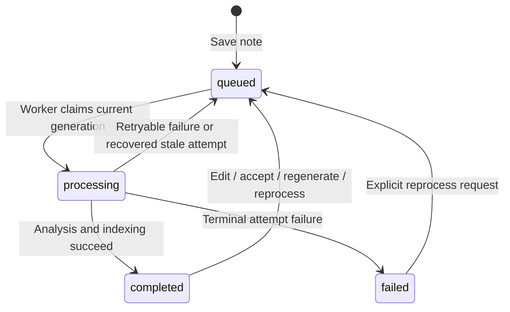

# Data models, validation and error handling

This file owns shared field definitions and response examples. The [endpoint reference](api-reference.md) identifies which model each operation accepts/returns. Examples use synthetic UUIDs and credentials; substitute real server-issued IDs/tokens at runtime.

## Transport conventions

| Item | Contract |
| --- | --- |
| Base URL | Origin only, such as `https://<agreed-api-host>`; paths below include `/v1` where required. |
| Resource IDs | UUID strings, created by the backend; never integer indexes. |
| Authentication | `Authorization: Bearer <FIKRAH access_token>` on protected operations. |
| JSON | UTF-8, `Content-Type: application/json`; use `Accept: application/json`. |
| Audio | `multipart/form-data` with one binary field named `file`; let the HTTP client set its boundary. |
| Streaming | POST with JSON input and `Accept: text/event-stream`. |
| Ownership | Derived from the authenticated session; no request `user_id` field. |
| Lists | Bare arrays, including `[]`; no `data`, `items`, `total`, page or cursor wrapper. |
| Deletion | `204` with an empty body; do not JSON-decode it. |
| Missing vs null | They differ for PATCH. Preserve field presence explicitly. |
| Timestamps | ISO 8601 strings with timezone, normally UTC; accept `Z` and `+00:00`. |
| Trailing slash | Use the documented path without a trailing slash; do not rely on redirect handling for writes. |
| Error text | Usually English and not a stable machine-readable error code; localize client messages by status/context. |
| Extra fields | No documented semantics; send only the documented keys even where a schema currently ignores extras. |

HTTP field names are snake_case. Client models may use local naming conventions with explicit JSON mapping.

## Request models

| Model / use | Fields and constraints |
| --- | --- |
| `Credentials` — login | `email`: valid email, normalized by trimming/lowercasing. `password`: string, **5–128 characters**, not trimmed. |
| `Registration` — both registration routes | `email` and `password` as above; required `name`: string, 1–120 Unicode code points after trimming outer whitespace; null characters rejected. Names may repeat; there is no username. |
| `ProfileNameUpdate` — PATCH `/v1/auth/me` | Required `name` with the same rules; no other body fields. |
| `EmailRequest` | `email`: valid email, trimmed/lowercased. |
| `EmailOtpRequest` | `email`: normalized valid email; `code`: exactly six ASCII digits as a **string**, including leading zeroes. |
| `ResetPasswordOtpRequest` | `email`, `code` as above; `new_password`: 5–128 characters, not trimmed. |
| `TokenRequest` — legacy verification | `token`: required string, 20–512 characters. |
| `ResetPasswordRequest` | `token`: 20–512 characters; `new_password`: 5–128 characters, not trimmed. |
| `GoogleLoginRequest` | `id_token`: required Google JWT string, 20–8,192 characters. `name`: optional/null fallback with the registration name constraints; used when the verified Google token has no usable name. |
| `RefreshRequest` — refresh/logout | `refresh_token`: required opaque string, 20–512 characters. |
| `ProjectInput` — create/rename | `name`: string, 1–120 characters; trimmed; whitespace-only rejected. |
| `NoteCreate` | `content`: required nonblank text, trimmed; default maximum 100,000 Unicode code points after trimming. `title`: optional/null string, maximum 240 characters, trimmed; blank becomes null. |
| `NoteUpdate` | At least one of `content` or `title` must be present. `content` must be nonblank/non-null when supplied; `title: null` clears the title. Same text/title constraints as creation. |
| `NoteFavoriteUpdate` | Required `is_favorite`: strict JSON boolean; no null, string or numeric coercion. This is a separate metadata PUT, not a content PATCH. |
| `ProposalAction` | `expected_processing_generation`: required integer >= 1. |
| `ProposalUpdate` | `expected_processing_generation`: integer >= 1; `refinement_proposal`: required nonblank trimmed text, same configured note-text size limit. Implemented route; product requirement remains unresolved. |
| `SearchRequest` | `query`: required nonblank trimmed string, 1–4,000 characters; `limit`: integer 1–50, defaults to 10. |
| `ConversationCreate` | Required JSON object; `title` optional/null, maximum 120 characters, trimmed; blank becomes null. Send `{}` for an automatic title. |
| `MessageCreate` | `content`: required nonblank trimmed string, 1–4,000 characters. |
| Audio upload | Exactly one file part named `file`; supported MIME type and configured size limit apply. No language/project/note fields. |

Field length constraints can be applied before a field validator trims text. Avoid sending excessive whitespace in bounded title/name/query fields. Do not trim or normalize passwords.

The server note limit is configured through `FIKRAH_NOTE_MAX_CHARACTERS`. Dart `String.length` counts UTF-16 code units; use code-point-aware counting (for example `runes.length`) if matching that specific server character limit. This does **not** establish a safe LLM token limit; large-note provider limits remain a release gap.

### PATCH examples

```json
{"title":"A deliberate user title"}
```

Updates only title, keeps content, and still schedules processing.

```json
{"title":null}
```

Clears title; processing may generate a new one. Omitting title keeps its current value.

```json
{"content":"Updated saved content"}
```

Changes content, clears its previous proposal and schedules processing.

`{}`, `{"content":null}` and whitespace-only content are invalid. Do not serialize omitted update fields as null automatically.

## Response models

### Message

```json
{"message":"Email verified"}
```

One `message: string`. Success message wording varies by operation; status and workflow determine the next screen.

### AuthTokens

```json
{
  "access_token":"<server-issued-access-token>",
  "refresh_token":"<server-issued-opaque-refresh-token>",
  "token_type":"bearer",
  "expires_in":900
}
```

| Field | Type | Meaning |
| --- | --- | --- |
| `access_token` | string | FIKRAH JWT used for protected requests. |
| `refresh_token` | string | Secret opaque token used only by refresh/logout requests. |
| `token_type` | string | Currently `bearer`. |
| `expires_in` | integer | Access lifetime in seconds, currently 900 (15 minutes). |

Refresh tokens have a 30-day lifetime per newly issued token and rotate on every successful refresh. This is not an absolute 30-day family-lifetime promise. Store both replacement tokens together. No user/project information is included in this response.

### UserView

```json
{
  "id":"66666666-6666-4666-8666-666666666666",
  "email":"reader@example.com",
  "email_verified":true,
  "name":"Reader Name"
}
```

Fields: `id: UUID`, `email: string`, `email_verified: boolean`, `name: string | null`. Legacy accounts may have a null name; never invent one from the email. No username, profile image, role, plan or provider-key fields are returned. Name is display metadata, not an authentication identifier. A subsequent Google login fills a missing name when available and preserves a name already saved by the user.

### ProjectView

```json
{
  "id":"11111111-1111-4111-8111-111111111111",
  "name":"General",
  "is_general":true,
  "created_at":"2026-11-23T10:00:00Z"
}
```

Fields: `id: UUID`, `name: string`, `is_general: boolean`, `created_at: datetime`. No `updated_at`, note count or description is returned. Use the boolean to recognize General even if its name changes.

### NoteView

```json
{
  "id":"22222222-2222-4222-8222-222222222222",
  "project_id":"11111111-1111-4111-8111-111111111111",
  "title":null,
  "content":"Review neural networks, then batch normalization.",
  "is_favorite":false,
  "concepts":[],
  "refinement_proposal":null,
  "revision":1,
  "processing_generation":1,
  "processing_status":"queued",
  "created_at":"2026-11-23T10:01:00Z",
  "updated_at":"2026-11-23T10:01:00Z"
}
```

| Field | Type / nullable | Mobile interpretation |
| --- | --- | --- |
| `id` | UUID | Saved identity; stable across edits. |
| `project_id` | UUID | Owning project. |
| `title` | string or null | User title or generated title; show a presentation placeholder if null. |
| `content` | string | Authoritative saved text. |
| `is_favorite` | boolean, non-null | Private favorite state, default false; set explicitly through N11. |
| `concepts` | array of strings | Derived concepts, normally at most eight after processing. |
| `refinement_proposal` | string or null | Suggested replacement; distinct from saved content. |
| `revision` | integer | Saved revision; advances on accepted PATCH/acceptance, including title-only PATCH. |
| `processing_generation` | integer | Version for processing/proposal actions; must be echoed as expected generation. |
| `processing_status` | string | Known states: `queued`, `processing`, `completed`, `failed`. |
| `created_at` | datetime | Creation time, preserved across edits. |
| `updated_at` | datetime | Last content/processing update; favorite-only writes preserve it. |

A completed result can look like:

```json
{
  "id":"22222222-2222-4222-8222-222222222222",
  "project_id":"11111111-1111-4111-8111-111111111111",
  "title":"Review neural networks and batch normalization",
  "content":"Review neural networks, then batch normalization.",
  "is_favorite":true,
  "concepts":["neural networks","batch normalization"],
  "refinement_proposal":"Start by reviewing neural networks, then study batch normalization.",
  "revision":1,
  "processing_generation":1,
  "processing_status":"completed",
  "created_at":"2026-11-23T10:01:00Z",
  "updated_at":"2026-11-23T10:01:08Z"
}
```

No language, failure-detail, progress-percentage, audio/PDF URL, client-created timestamp or weekday field exists. The schema currently represents status as a string, so handle an unknown state safely rather than crashing.

Existing derived fields can remain in queued/processing/failed responses after reanalysis. Do not present them as a fresh completed result. Saving/reprocessing is not a progress-percentage operation.

### SearchResult

```json
{
  "note_id":"22222222-2222-4222-8222-222222222222",
  "title":"Review neural networks and batch normalization",
  "content":"Review neural networks, then batch normalization.",
  "is_favorite":true,
  "score":0.82,
  "updated_at":"2026-11-23T10:01:08Z"
}
```

Fields: `note_id: UUID`, `title: string|null`, `content: string`, `is_favorite: boolean`, `score: number`, `updated_at: datetime`. Favorite state comes from current PostgreSQL data, not vector metadata. Returned as an ordered array. No guaranteed score threshold or exact-match interpretation.

### RelatedNoteView and ProjectGraph

Related-note result:

```json
{
  "note_id":"22222222-2222-4222-8222-222222222223",
  "title":"Batch normalization study notes",
  "shared_concepts":["batch normalization"],
  "updated_at":"2026-11-23T10:02:00Z"
}
```

Fields: `note_id: UUID`, `title: string|null`, `shared_concepts: string[]`, `updated_at: datetime`.

Graph response:

```json
{
  "nodes":[
    {
      "id":"22222222-2222-4222-8222-222222222222",
      "title":"Review neural networks and batch normalization",
      "concepts":["neural networks","batch normalization"],
      "updated_at":"2026-11-23T10:01:08Z"
    },
    {
      "id":"22222222-2222-4222-8222-222222222223",
      "title":"Batch normalization study notes",
      "concepts":["batch normalization"],
      "updated_at":"2026-11-23T10:02:00Z"
    }
  ],
  "edges":[
    {
      "source_note_id":"22222222-2222-4222-8222-222222222222",
      "target_note_id":"22222222-2222-4222-8222-222222222223",
      "shared_concepts":["batch normalization"]
    }
  ]
}
```

`GraphNode`: `id`, nullable `title`, `concepts`, `updated_at`. `GraphEdge`: source/target UUIDs and `shared_concepts`. The object always has `nodes` and `edges` arrays. No edge ID, numeric weight, coordinates or cluster label is supplied.

### ConversationView / ConversationDetail

Summary:

```json
{
  "id":"33333333-3333-4333-8333-333333333333",
  "project_id":"11111111-1111-4111-8111-111111111111",
  "title":null,
  "created_at":"2026-11-23T10:03:00Z",
  "updated_at":"2026-11-23T10:03:00Z"
}
```

Fields: `id: UUID`, `project_id: UUID`, `title: string|null`, `created_at`, `updated_at`. Detail has the same fields plus `messages: MessageView[]` in chronological order. Empty history is `[]`.

### MessageView / SourceView / MessageSubmission

```json
{
  "conversation":{
    "id":"33333333-3333-4333-8333-333333333333",
    "project_id":"11111111-1111-4111-8111-111111111111",
    "title":"What should I review first?",
    "created_at":"2026-11-23T10:03:00Z",
    "updated_at":"2026-11-23T10:04:00Z"
  },
  "user_message":{
    "id":"44444444-4444-4444-8444-444444444444",
    "role":"user",
    "content":"What should I review first?",
    "supported":null,
    "sources":[],
    "created_at":"2026-11-23T10:04:00Z"
  },
  "assistant_message":{
    "id":"55555555-5555-4555-8555-555555555555",
    "role":"assistant",
    "content":"Start with neural networks, then review batch normalization.",
    "supported":true,
    "sources":[
      {
        "note_id":"22222222-2222-4222-8222-222222222222",
        "title":"Review neural networks and batch normalization"
      }
    ],
    "created_at":"2026-11-23T10:04:00.000001Z"
  }
}
```

`MessageView` fields: `id: UUID`, `role: string`, `content: string`, `supported: boolean|null`, `sources: SourceView[]`, `created_at: datetime`. Known roles are `user` and `assistant`.

`SourceView` fields: `note_id: UUID`, `title: string|null`. Sources do not contain snippets or a permanent title snapshot; reading history resolves current accessible note titles. Deleted notes' citations are removed; message text is not rewritten as a consequence.

`MessageSubmission` is exactly `conversation`, `user_message`, `assistant_message`. It is returned by the JSON message route and as the payload of SSE `complete`. It is **not** the shape of an individual delta.

### TranscriptionView

```json
{"text":"Review neural networks, then batch normalization."}
```

Only `text: string`. No note ID, audio duration, detected language, confidence or stored file URL is returned.

### ReadinessView

```json
{
  "status":"unavailable",
  "checks":{
    "postgresql":"ready",
    "redis":"ready",
    "qdrant":"unavailable"
  }
}
```

`status` is `ready` or `unavailable`; each check has the same two string values. HTTP is `200` only when all checks succeed, otherwise `503`. No SMTP/LLM/worker readiness guarantee is included.

## Processing-state transitions



The client can miss intermediate states. Treat each GET response as a current snapshot rather than requiring every transition to be observed.

| Action | Revision | Generation | Queues processing |
| --- | --- | --- | --- |
| First create | Starts at 1 | Starts at 1 | Yes |
| PATCH title/content, including unchanged values | +1 | +1 | Yes |
| Reprocess while completed/failed | Same | +1 | Yes |
| Reprocess while queued/processing | Same | Same | No new generation |
| Regenerate completed proposal | Same | +1 | Yes |
| Accept completed proposal | +1 | +1 | Yes |
| Edit completed existing proposal | Same | +1 | No |
| Reject current proposal | Same | Same | No |
| Worker fills title/concepts/proposal | Same | Same | Completes existing work |

## HTTP errors and recovery

Typical business/middleware error:

```json
{"detail":"Note not found"}
```

Typical validation error:

```json
{
  "detail":[
    {
      "type":"missing",
      "loc":["header","Idempotency-Key"],
      "msg":"Field required",
      "input":null
    }
  ]
}
```

Validation entries may include additional fields such as `ctx`, different error types, and echoed input. Parse `detail` as either a string or an array. Do not persist/log full authentication requests or error payloads that may echo passwords/tokens/OTP codes. Transport failures and infrastructure 5xx responses can have non-JSON bodies; provide a safe fallback.

| Status | Meaning in this API | Mobile action |
| --- | --- | --- |
| `400` | Invalid/expired/used/exhausted OTP or legacy email action token. | Offer code re-entry/resend or legacy link renewal; do not refresh access tokens. |
| `401` | Missing/invalid/revoked access session, wrong password, invalid Google identity or invalid refresh token, depending on route. | Refresh once only for a protected-resource access failure. Login/Google/refresh failures have separate handling. |
| `403` | Valid password but email not verified. | Open verification screen and resend option. |
| `404` | Missing/inaccessible note/project/conversation. | Remove stale selection/cache as appropriate; do not infer another account owns it. |
| `409` | General deletion, reused key with different create body, stale proposal generation, incomplete proposal state, Google identity conflict or concurrent chat exchange. | Route-specific reload/review; no blind automatic mutation replay. |
| `410` | Replayed creation key refers to an already deleted note. | Do not recreate it with the old key. A new intentional save needs a new key. |
| `413` | HTTP body or recording exceeds size limit. | Reduce input; retries with the same bytes do not help. |
| `415` | Incorrect multipart content type or unsupported audio MIME type. | Fix upload encoding/media type. |
| `422` | Invalid/missing fields, UUID, text, key or audio data. | Map validation errors to fields; avoid a network-retry loop. |
| `429` | Request quota or password/Google execution admission exhausted. | Respect `Retry-After` where provided, show a countdown and retain draft. |
| `503` | Dependency/provider/limiter failure, missing provider configuration, execution budget or readiness failure. | Retain data; allow a bounded user retry. It is not “wrong password” or “no matching note.” |
| `500` / network failure | Unexpected or uncertain outcome. | Preserve draft; reconcile non-idempotent writes before retrying. |

Default quotas are configurable, except the current per-address email-send policy:

| Work | Default limit / behavior |
| --- | --- |
| Password login | Five attempts per normalized email per 60-second window. |
| Email OTP | Six ASCII digits; 10 minutes from issuance; single-use; five incorrect submissions exhaust that code. Wrong/expired/used/unknown all return generic `400`. |
| Google sign-in | 20 attempts per client IP per 60-second window; 10-second verification budget, eight verifier slots per API process. |
| LLM-budgeted routes | Ten attempts per authenticated user per 60-second window shared across note create/update/reprocess/regenerate/accept, search, transcription, JSON chat and streaming chat. |
| Proposal edit/reject, reads, project/conversation CRUD | No LLM request budget on these routes; normal authorization still applies. |
| Email actions | 60-second cooldown and five send attempts/address/hour; generic `202` can be returned without sending. |

An HTTP quota counter is not the same as paid provider tokens. Idempotent replays, no-op retries, conflicts and greetings can still consume a request counter because the dependency runs before the workflow.

Default non-audio body cap: **416,384 bytes**. Default recording cap: **10,485,760 bytes (10 MiB)**, with an additional 65,536-byte multipart-body allowance. Audio size can be configured lower. Headers/JSON encoding and non-ASCII content affect byte size.

Supported audio MIME values: `audio/wav`, `audio/x-wav`, `audio/mp3`, `audio/mpeg`, `audio/mp4`, `audio/m4a`, `audio/x-m4a`, `audio/aac`, `audio/ogg`, `audio/flac`, `audio/webm`. A filename extension alone does not establish type.

See [Flutter integration](flutter-integration.md) for refresh, retry and SSE state handling.
